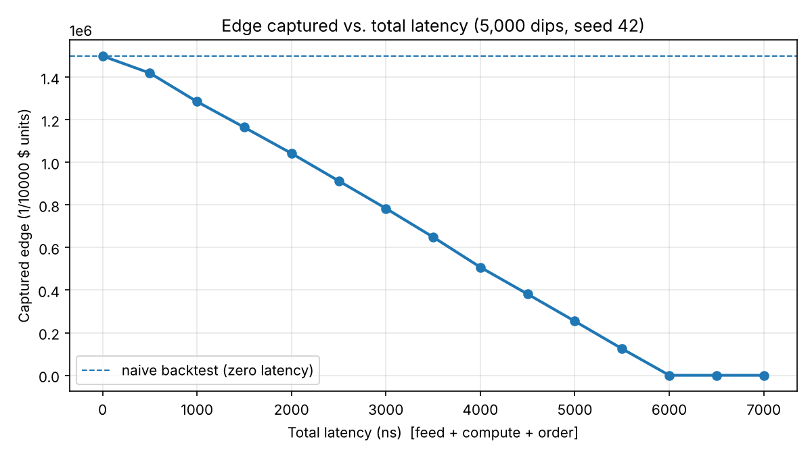

# Latency-Aware Backtester

A discrete-event backtester in C++20 that models **feed, compute and order latency as explicit time offsets**, so a strategy trades against the market as it is when its order *arrives*, not as it was when the strategy decided.

A naive backtest assumes zero latency and instant fills at the quoted price. This project shows how much of a strategy's edge that assumption hides.



## Result

Same strategy, same seeded feed (5,000 mispriced-ask "dips", seed 42), swept over total latency:

| Total latency | Dips captured | Edge captured (1/10000 $ units) | % of naive |
|---|---|---|---|
| 0 ns (naive) | 5,000 | 1,500,000 | 100.0% |
| 1,000 ns | 4,285 | 1,285,500 | 85.7% |
| 3,000 ns | 2,613 | 783,900 | 52.3% |
| 5,000 ns | 847 | 254,100 | 16.9% |
| 6,000 ns and above | 0 | 0 | 0% |

At 3 µs of total latency the strategy keeps about half of the edge a naive backtest reports. At 6 µs it keeps none. Full data: [`results/latency_sweep.csv`](results/latency_sweep.csv).

The shape matches the model. Dip lifetimes are uniform on [200, 6000] ns, so the fraction still alive when the order arrives is about `(6000 - L) / 5800`, a near-linear decline.

## How it works

```
t                      exchange applies the event to the TRUE book
t + feedLatency        strategy SEES the event (its view is stale)
  + computeLatency     strategy finishes deciding and sends an order
  + orderLatency       order ARRIVES at the exchange and matches the TRUE book
```

- **Two order books.** `trueBook` is updated at exchange time `t`. `strategyBook` is updated at `t + feedLatency`. The strategy only ever sees the second one.
- **Event scheduler.** A min-heap ordered by timestamp, with a monotonically increasing sequence number as a tie-break. Events at the same nanosecond pop in scheduling order, so runs are reproducible. Historical events are scheduled first, so **the exchange wins ties against the strategy's order**, which is a conservative convention.
- **Matching.** `OrderBook::match` walks the opposite side in price-time priority, fills at the *resting order's* price, and discards any unfilled remainder (immediate-or-cancel).
- **Portfolio.** Cash and position as signed 64-bit integers. Prices are integers in 1/10000 of a dollar, so there is no floating point anywhere.
- **Strategy.** `EdgeTakerStrategy` buys when the best ask it can see drops by at least N ticks.

Built on the earlier projects in this series: the pool allocator backs every order, and the book and message types come from the ITCH parser and order book.

## Testing

29 test cases, 692 assertions (Catch2). Highlights:

- Scheduler pops in timestamp order, and ten equal-timestamp events pop in insertion order.
- Matching: price-time priority, fills at the resting price, FIFO within a level, buy and sell sides, no fill when the spread isn't crossed.
- Regression tests for bugs found while building this: share underflow on over-cancel and over-execute, partial cancel leaving the order resting, a 32-bit overflow in notional value, `addOrder` on a full pool and on a duplicate ID.
- **The one-nanosecond cliff:** with a dip deleted at t=2000, an order arriving at t=1999 fills and an order arriving at exactly t=2000 gets nothing.

## Performance

Release build, 4-core 2.7 GHz CPU, Windows / MSVC, wall-clock time (Google Benchmark):

| Benchmark | Result |
|---|---|
| Event scheduler, push + pop, 1,000 events | ~79 ns per event |
| Event scheduler, push + pop, 100,000 events | ~370 ns per event |
| `match`: one single-share fill | ~143 ns |
| End-to-end simulation, 4,000 historical messages | ~2.5 ms (~1.5M messages/s) |

- End-to-end time is the same at 0, 3,000 and 6,000 ns of latency. Latency changes event timestamps, not the amount of work.
- The scheduler is slower per event at 100,000 events, probably because the heap no longer fits in the 3 MB L3 cache. This has not been profiled.
- `match` returns a `std::vector<Fill>`, so each call likely allocates. A caller-supplied buffer would remove that; not done.

## Build and run

```
cmake -B build
cmake --build build --config Release
build/tests/Release/tests                  # run the test suite
build/benchmarks/Release/benchmarks        # run the benchmarks
build/Release/sweep > results/latency_sweep.csv
```

## Known limitations

- **The edge is constructed.** The curve shows the simulator reacts correctly to latency. It says nothing about alpha in a real market, because the dips and their lifetimes are generated.
- **Fixed latency.** Real latency has jitter, which would smear the cliff into a gradual decline. Drawing latency from a distribution is the natural next step.
- **No market impact.** The strategy's fills don't change what the historical feed does afterwards.
- **One instrument, one strategy.** The pool is fixed at 100,000 order slots. `addOrder` returns `false` when it is exhausted.
- **Reproducible per platform, not across platforms.** The feed is seeded, but `std::uniform_int_distribution` can give different numbers on different standard libraries. The committed CSV comes from the MSVC build, so CI checks properties that hold anywhere (P&L = 6 x position, P&L never rises with latency, zero latency captures every dip) instead of diffing the file.
- **Single-threaded.** No attempt at throughput, since this project is about simulation correctness.
- **Headers are copied** from the sibling repos rather than shared as a library.